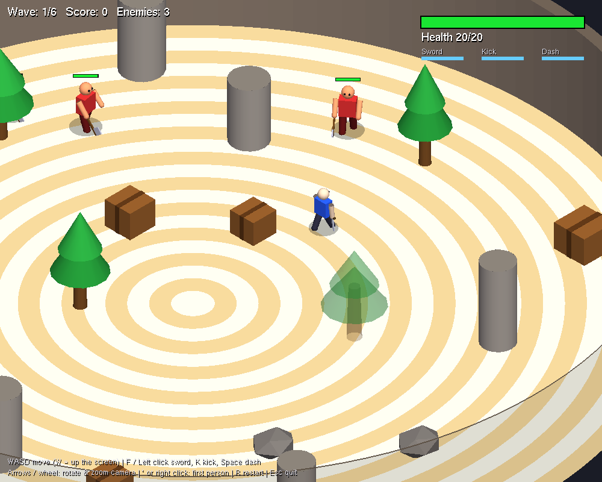
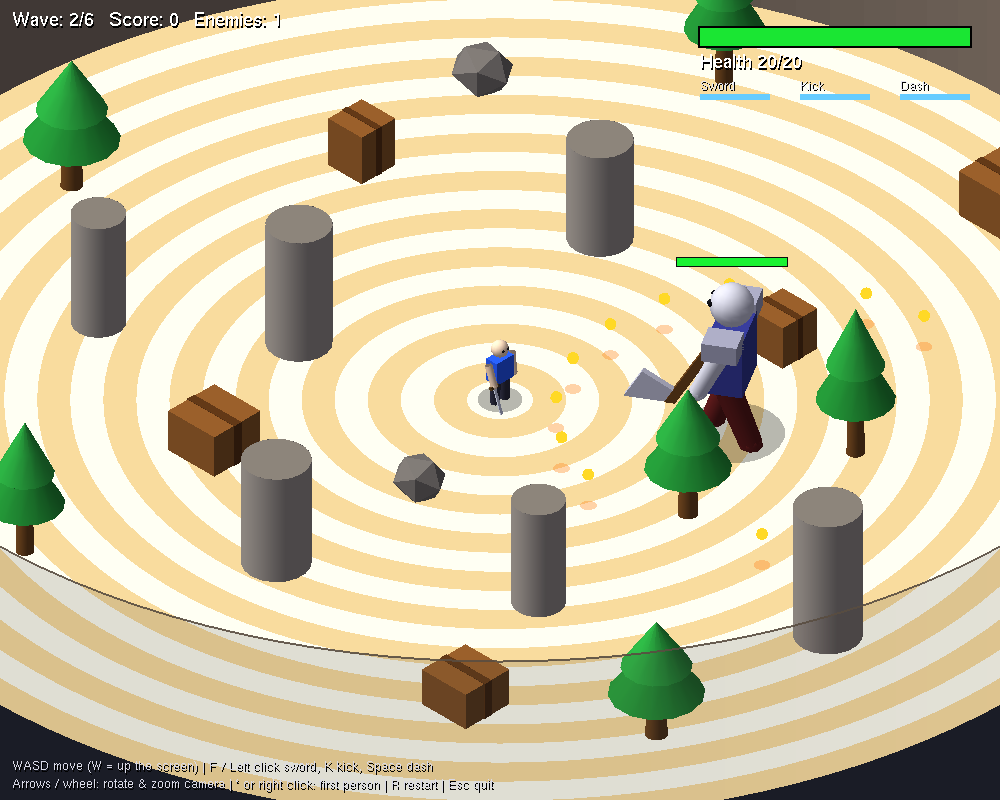
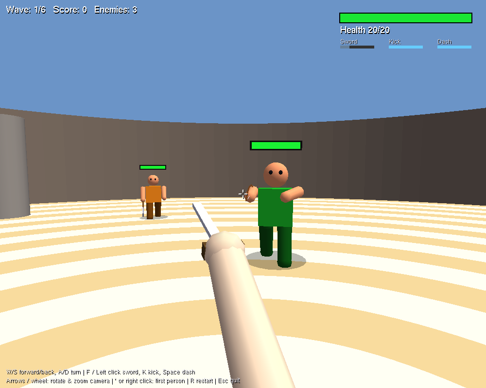

# Gladiator Arena (OpenGL)

A wave-based 3D arena combat game written in Python with PyOpenGL and GLUT. Fight through six waves of melee fighters, archers and boss fights inside a circular arena, in either an isometric or a first-person view.



| Boss wave | First person |
|---|---|
|  |  |

## Features

- **Isometric camera** with true isometric angle, smooth follow, rotation and zoom
- **First-person mode** with an animated sword arm, kick and crosshair
- **Six waves** that alternate between enemy groups and boss fights
- **Enemy types:** standard, fast, heavy (armoured) and ranged archers that keep their distance and shoot
- **Boss** with a charge attack and a spread of projectiles
- **Melee combat:** sword swing and kick, each with its own range, arc, knockback and cooldown, plus a dash
- **Animated characters:** walking legs and arms, attack poses and a hit flash
- **Random obstacles** (pillars, crates, rocks, trees) placed fresh every wave
- **See-through scenery:** the near side of the wall and anything blocking your view of the player fade out
- **HUD** with health, cooldown bars, wave and score

## Requirements

- Python 3.8+
- PyOpenGL and a GLUT library (freeglut)

```bash
pip install -r requirements.txt
```

## Run

```bash
python arena_battle.py
```

## Controls

| Key | Isometric view | First-person view |
|---|---|---|
| W A S D | Move (W is up the screen) | W/S forward and back, A/D turn |
| F / Left click | Sword attack | Sword attack |
| K | Kick | Kick |
| Space | Dash | Dash |
| Arrow keys | Rotate (left/right) and zoom (up/down) camera | |
| Mouse wheel | Zoom | |
| `` ` `` / Right click | Switch to first person | Switch to isometric |
| R | Restart | Restart |
| Esc | Quit | Quit |

## Troubleshooting

**`NullFunctionError: Attempt to call an undefined function glutInit`**

PyOpenGL from pip doesn't always ship the freeglut library on Windows. Download `freeglut.dll` (64-bit) and place it next to `arena_battle.py` or in `C:\Windows\System32`, then run the game again.

On Linux, install it with `sudo apt install freeglut3-dev`.

## Built with

Python, PyOpenGL, GLUT (freeglut). Everything is drawn with the fixed-function OpenGL pipeline using primitives such as cubes, cylinders, spheres and cones, with no external models or textures.
